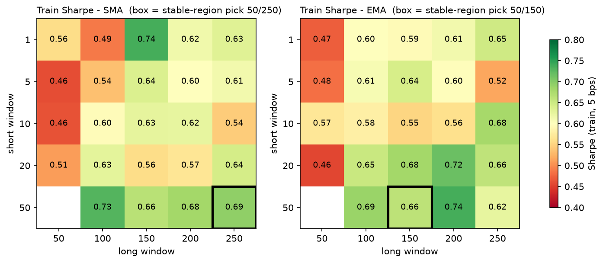
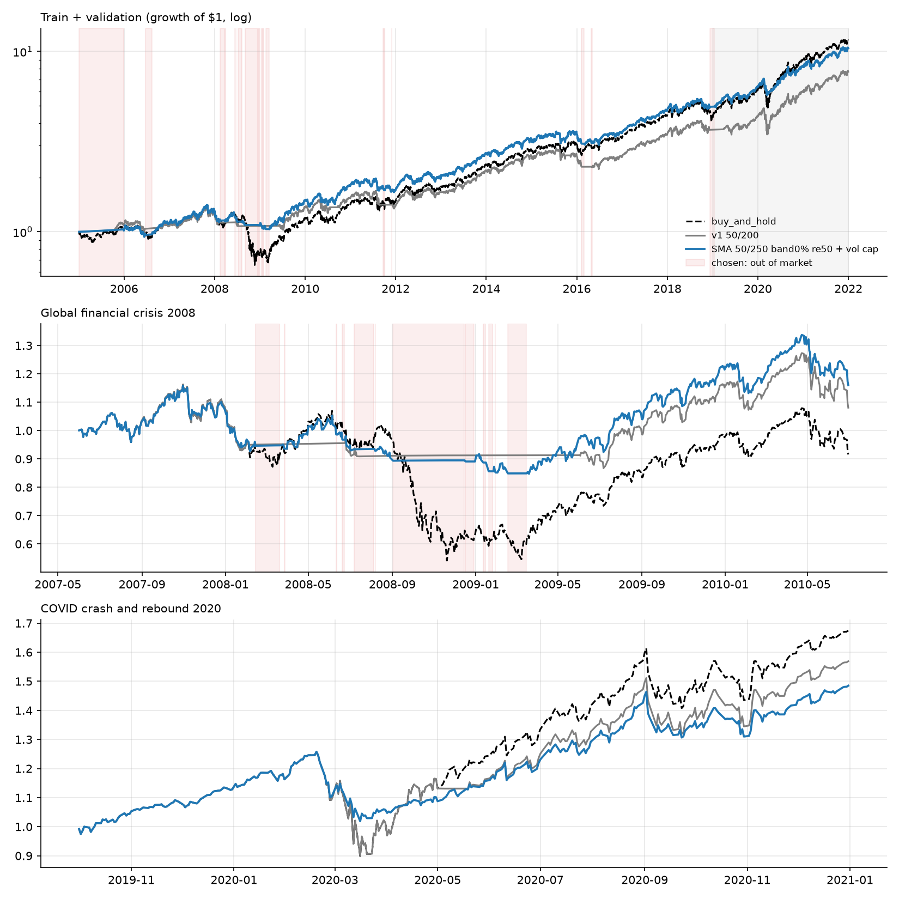

## 4.1 Strategy 1: Moving-average crossover

### Idea
Moving-average rules are among the oldest market-timing tools, and some of the most studied (Brock, Lakonishok and LeBaron, 1992; Faber, 2007; Zakamulin, 2017). The intuition is simple. Equity indices trend, and the worst losses come in long bear markets that unfold over months rather than days. If the short-term average price is above the long-term average, the trend is up and we hold QQQ. If it is below, we move to cash and earn the Treasury-bill rate. The goal is not to beat the market every year. It is to sit out most of a prolonged decline such as 2008, at the cost of lagging at turning points and occasionally being whipsawed in sideways markets.

### Method
All signals use dividend-adjusted closing prices and trailing windows only. The position chosen at the close of day *t* is held from *t* to *t*+1, and the backtest engine applies that one-day lag, so the strategy cannot use same-day information it would not have had (Section 3). A position *p* ∈ [0, 1] is the fraction of capital in QQQ; the remaining 1 − *p* earns the 13-week T-bill rate. Every result is net of 5 bps one-way trading costs.

We built the strategy in three steps. Each step was motivated by a weakness of the previous version and tuned only on the training period (2005–2018):

- **v1, textbook crossover.** Long when the 50-day simple moving average (SMA) is above the 200-day SMA ("golden cross"), otherwise flat.
- **v2, fast re-entry.** v1 has one serious failure mode. After a fast, V-shaped crash, the slow averages take months to cross back up, so the strategy misses the rebound. v2 is therefore also long whenever the price is back above its 50-day average. The window pair was re-tuned at the same time (SMA 50/250).
- **v3, volatility cap.** The position is scaled by min(1, σ* / σ̂ₜ), where σ̂ₜ is the annualized volatility of the last 20 daily returns. Volatility clusters, and crashes happen in high-volatility regimes, so cutting exposure when σ̂ₜ is high improves risk-adjusted returns (Moreira and Muir, 2017). The target σ* is set to **QQQ's own realized volatility over the training period (20.2%)**. Exposure is therefore only reduced when the market is more turbulent than usual, and never levered above 1. To avoid trading every day, the held size changes only when the trend signal changes or the target size drifts by more than 10 percentage points.

**Parameter selection.** Every selection rule was written down before any results were viewed (`notebooks/01_moving_average/tuning.ipynb`):
1. We searched a grid of 48 window pairs (short ∈ {1, 5, 10, 20, 50} × long ∈ {50, …, 250}, simple and exponential averages) on the training data (Figure 4.1).
2. We picked the **centre of the most stable region** (the highest Sharpe averaged over each 3×3 neighbourhood) rather than the single best cell.
3. We searched bands and re-entry windows on train, which left four candidates.
4. We evaluated those four once on the validation period (2019–2021) and chose by Sharpe ratio with a drawdown constraint.
5. The volatility cap was adopted only because it improved on the uncapped version on train *and* confirmed on validation.

### Results
**Table 4.1: Slot 1 vs buy-and-hold** (5 bps costs; Sharpe and Sortino in excess of T-bills)

| | Period | Mean daily | Std daily | Ann. mean | Ann. vol | CAGR | Cum. return | Max DD | Sharpe |
|---|---|---|---|---|---|---|---|---|---|
| v1 SMA 50/200 | Train | 0.041% | 0.93% | 10.4% | 14.7% | 9.8% | 268% | **−25.4%** | 0.62 |
| v2 + re-entry | Train | 0.053% | 1.04% | 13.2% | 16.5% | 12.6% | 426% | −30.6% | 0.73 |
| **v3 + vol cap** | Train | 0.050% | 0.93% | 12.5% | 14.8% | 12.1% | 394% | −26.8% | **0.76** |
| Buy & hold | Train | 0.050% | 1.27% | 12.6% | 20.2% | 11.1% | 338% | −53.4% | 0.56 |
| v1 SMA 50/200 | Validation | 0.109% | 1.53% | 27.6% | 24.3% | 27.9% | 109% | −28.6% | 1.10 |
| v2 + re-entry | Validation | 0.133% | 1.55% | 33.5% | 24.7% | 35.6% | 150% | −28.6% | 1.33 |
| **v3 + vol cap** | Validation | 0.105% | 1.12% | 26.4% | **17.8%** | 28.1% | 111% | **−19.0%** | **1.44** |
| Buy & hold | Validation | 0.140% | 1.57% | 35.3% | 24.9% | 37.9% | 163% | −28.6% | 1.38 |

**The final strategy (v3) beats buy-and-hold on risk-adjusted return in both periods.** On train it earned a higher compound return (12.1% vs 11.1% a year) with roughly three-quarters of the volatility (14.8% vs 20.2%) and half the maximum drawdown (−26.8% vs −53.4%). On validation it had a higher Sharpe ratio (1.44 vs 1.38) and a much smaller drawdown (−19.0% vs −28.6%). However, its return was lower (28.1% vs 37.9% a year), because a strategy that holds less in turbulent markets gives up some upside in a strong bull market. Its Sortino ratio is also higher in both periods (1.06 vs 0.80 on train, 1.98 vs 1.96 on validation).

**Table 4.2: Behaviour in market stress** (cumulative return over each window)

| Episode | v1 | v2 | v3 | Buy & hold |
|---|---|---|---|---|
| Financial crisis (Oct 2007 – Mar 2009) | −20.3% | −29.4% | −25.7% | −52.3% |
| Q4 2018 sell-off (1 Oct – 24 Dec 2018) | −10.7% | −11.1% | −9.2% | −22.5% |
| COVID crash (20 Feb – 23 Mar 2020) | −27.9% | −27.9% | **−18.2%** | −27.9% |
| COVID crash and rebound (20 Feb – 31 Dec 2020) | +24.7% | **+33.1%** | +18.0% | **+33.1%** |

Table 4.2 shows how each improvement works. In the slow-moving 2008 crisis every version avoided about half the loss. The COVID crash was too fast for any trend signal: neither crossover turned negative, so v1 and v2 stayed fully invested and took the full −27.9%. v3's volatility cap reacted to the spike in volatility instead, averaging about 54% exposure during the crash and cutting the loss by roughly a third. Re-entry let v2 capture the full rebound, while v1 sat in cash until May 2020 (Figure 4.2). The volatility cap is the reason v3 recovered more slowly than v2 after the crash: it kept exposure low until volatility subsided.

**Robustness.** Costs barely matter. The strategy trades about 2.7 times its capital per year, and the train Sharpe moves only from 0.77 to 0.74 as one-way costs rise from 0 to 20 bps (validation: 1.44 to 1.42). The choice of window pair matters less than the extra rules. Across the 48 plain crossovers on train, Sharpe ranged from 0.39 to 0.68, with a median of 0.56 (equal to buy-and-hold). Only 46% of them beat buy-and-hold. Long windows of 100 days or more were clearly better than 50 days (median 0.57 vs 0.41).

### Strengths, weaknesses and limitations
**Strengths.**
- It is simple, transparent and cheap to trade.
- It cut the 2008 drawdown roughly in half.
- With the volatility cap, it delivered higher risk-adjusted returns than buy-and-hold in both development periods.
- The only data-driven parameter of the cap (σ*) comes from the training data, not from the results.

**Weaknesses.**
- Trend signals lag at turning points, so fast crashes like COVID 2020 are not avoided.
- The volatility cap sacrifices upside in strong bull markets (validation return 28% vs 38% a year) and slows re-entry after a crash.
- Because it is often partly in cash, v3 can trail buy-and-hold for long stretches, which is hard to stick with in practice.

**Limitations.**
1. **The Sharpe differences are not statistically significant.** 95% block-bootstrap confidence intervals are about ±0.5 (v3: [0.31, 1.28] on train, [0.33, 2.62] on validation; buy-and-hold: [0.12, 1.09] and [0.29, 2.68]), and they overlap heavily. The lower volatility and drawdowns are more robust than the Sharpe difference itself.
2. **The validation period could barely tell the candidate settings apart.** In the 2019–2021 bull market every candidate was invested about 98% of the time, so the choice rests mainly on the training period.
3. **The edge depends on a few bear markets.** A recent QQQ study (FinLab, 2026) finds that moving-average rules earn their advantage almost entirely from a single deep bear market, which is consistent with the out-of-sample decay documented by Zakamulin (2017). The test period (2022–2026) contains one such market (2022), so it is a real test of the timing rather than a formality.
4. **We also tested ideas from the literature that did not help, and report them for completeness:**
   - Checking the signal only at month-end or week-end (Faber, 2007) exited too late: train Sharpe 0.63 and 0.71, against 0.73 for v2 with daily checks.
   - Adding a 12-month momentum filter (Clare et al., 2016) reduced Sharpe to 0.57 (with AND) and 0.69 (with OR).
   - Kaufman's adaptive moving average (Kaufman, 1995) traded too often, for a Sharpe of 0.04.
   - Faber's exact 10-month rule on QQQ scored a Sharpe of 0.58, barely above buy-and-hold's 0.56.

   All of these figures use the same engine as Table 4.1.

Out-of-sample test results for all strategies are reported in Section 6.

*Figures:* 4.1 Train Sharpe heat map: `notebooks/01_moving_average/figures/heatmap_train_sharpe.png` · 4.2 Growth of $1 with close-ups of 2008 and 2020: `notebooks/01_moving_average/figures/equity_and_crashes.png` · 4.3 Drawdowns: `results/strategies/ma_crossover/v3_volcap/drawdown.png` · 4.4 Calendar-year returns: `results/strategies/ma_crossover/v3_volcap/annual_returns.png`

### References
- Brock, W., Lakonishok, J. and LeBaron, B. (1992). Simple technical trading rules and the stochastic properties of stock returns. *Journal of Finance*, 47(5), 1731–1764.
- Clare, A., Seaton, J., Smith, P. N. and Thomas, S. (2016). The trend is our friend: Risk parity, momentum and trend following in global asset allocation. *Journal of Behavioral and Experimental Finance*.
- Faber, M. T. (2007). A quantitative approach to tactical asset allocation. *Journal of Wealth Management*, 9(4), 69–79.
- FinLab Quant Research (2026). TQQQ 200-day moving average strategy: 7 leveraged ETF rules. finlab.finance (blog post).
- Kaufman, P. J. (1995). *Smarter Trading*. McGraw-Hill.
- Moreira, A. and Muir, T. (2017). Volatility-managed portfolios. *Journal of Finance*, 72(4), 1611–1644.
- Zakamulin, V. (2017). *Market Timing with Moving Averages: The Anatomy and Performance of Trading Rules*. Palgrave Macmillan.
