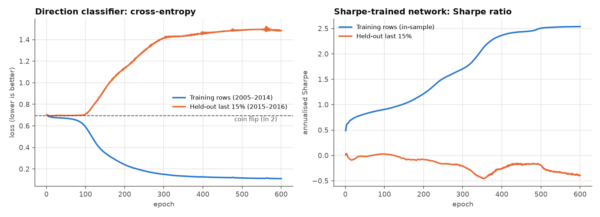
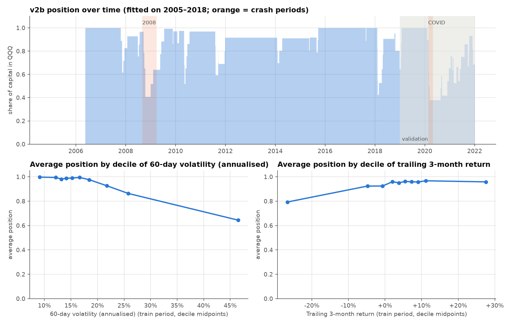
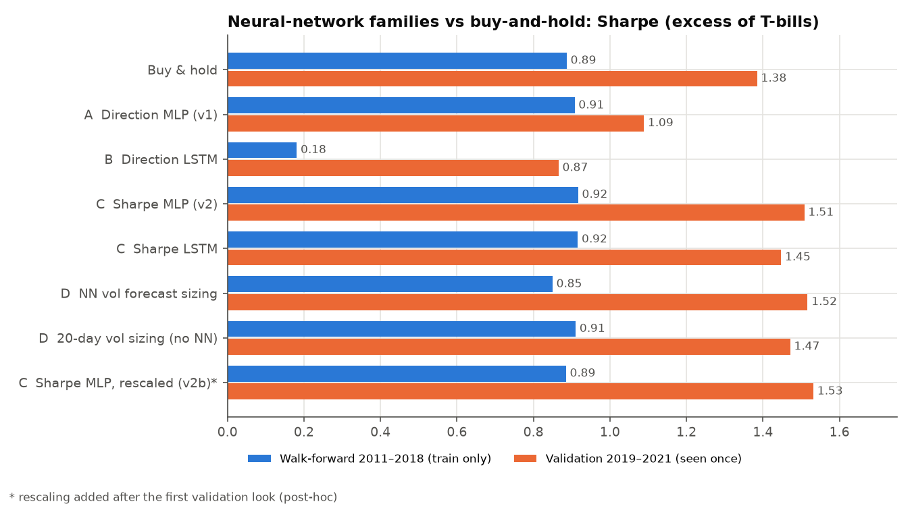

## 4.2 Strategy 2: Neural network

### Idea
The brief asks for a neural network trained on previous days' open, high, low and close prices to predict price movements. Neural networks are flexible function approximators, and the hope is that they find non-linear patterns in recent price action that simple rules miss.

The finance literature is sceptical about predicting the *direction* of a broad index a day ahead:
- Classic return predictors fail out of sample (Welch and Goyal, 2008).
- Even the best machine-learning models explain well under 1% of monthly stock returns (Gu, Kelly and Xiu, 2020).
- Many of the striking deep-learning results come from cross-sections of hundreds of stocks, not from timing one index (Fischer and Krauss, 2018).

Two alternatives are better supported:
1. **Train the network on the trading objective itself**: output the position directly and maximise the Sharpe ratio, instead of classifying up and down days ("Deep Momentum Networks", Lim, Zohren and Roberts, 2019).
2. **Use the network for what is predictable**: volatility (Bucci, 2020; Christensen, Siggaard and Veliyev, 2023).

We tested the brief's design and both alternatives under the same rules.

### Method
All features use data up to the close of day *t* only. Positions are held from *t* to *t*+1, the uninvested share earns T-bills, and results are net of 5 bps one-way costs (Section 3). The network is a small multi-layer perceptron written in NumPy. Its gradients are verified against finite differences, and it is trained with Adam and weight decay.

**Leakage controls:**
- Targets are built inside `fit()` from the training data only. The last training day has no next-day target and is dropped.
- Standardisation uses training statistics.
- Early stopping holds out the **last** 15% of the training window, in time order.
- Every configuration is trained with 5 random seeds, and the strategy trades their **average** output.
- An audit (Section 3) confirms that positions do not change when future data is removed or replaced, that no data is read outside the engine, and that the strategy has no edge on random-walk prices.

**Model selection** was pre-registered (`notebooks/02_neural_net/PROTOCOL.md`).
- Hyper-parameters were chosen **only within the training period**, by a walk-forward test.
- Each model was refitted on 2005–2010, 2005–2012, 2005–2014 and 2005–2016, then traded the following two years. The four out-of-fold windows (2011–2018) were scored together.
- Validation (2019–2021) was looked at once.

We compared four families (40 configurations):
- **A, direction classifier (the brief).** Inputs are 20 days of lagged daily returns, intraday range, candle body, overnight gap and a volume z-score. The network outputs P(up), and the strategy is long when P(up) > 0.5.
- **B, the same with an LSTM** (PyTorch, research only).
- **C, Sharpe-trained network.**
  - Inputs: volatility-normalised returns over 1 day to 12 months, three MACD trend signals and log volatility.
  - The sigmoid output *is* the position in [0, 1].
  - The loss is the negative Sharpe ratio of the resulting returns after a turnover penalty.
  - Also tested as an LSTM.
- **D, neural volatility forecast.** A network forecasts next-week or next-month volatility from HAR-style inputs (Corsi, 2009), and the position is min(1, σ* / σ̂).

**Decision ladder.** v1 is the brief's design. A more complex version replaces it only if (i) its walk-forward Sharpe on train is higher and (ii) on validation its Sharpe is no more than 0.05 below and its drawdown is no worse.

### Results
**Table 4.3: Slot 2 vs buy-and-hold** (5 bps costs; Sharpe in excess of T-bills). *Train rows are in-sample for a fitted model; the walk-forward column is the honest training-period estimate.*

| | Period | Mean daily | Std daily | Ann. mean | Ann. vol | CAGR | Cum. return | Max DD | Sharpe | Walk-forward Sharpe 2011–18 |
|---|---|---|---|---|---|---|---|---|---|---|
| v1 direction | Train | 0.112% | 1.04% | 28.3% | 16.5% | 30.9% | 4195% | −18.0% | 1.64 ⚠️ | 0.91 |
| v2 Sharpe-trained | Train | 0.021% | 0.32% | 5.2% | 5.2% | 5.2% | 103% | −10.9% | 0.77 | **0.92** |
| **v2b rescaled** | Train | 0.050% | 1.00% | 12.7% | 15.9% | 12.1% | 395% | −39.2% | 0.72 | 0.89 |
| Buy & hold | Train | 0.050% | 1.27% | 12.6% | 20.2% | 11.1% | 338% | −53.4% | 0.56 | 0.89 |
| v1 direction | Validation | 0.094% | 1.32% | 23.7% | 21.0% | 23.9% | 90% | **−33.2%** | 1.09 | |
| v2 Sharpe-trained | Validation | 0.033% | 0.32% | 8.4% | 5.0% | 8.6% | 28% | −5.9% | 1.51 | |
| **v2b rescaled** | Validation | 0.093% | 0.93% | 23.5% | 14.8% | 25.1% | 96% | −16.2% | **1.53** | |
| Buy & hold | Validation | 0.140% | 1.57% | 35.3% | 24.9% | 37.9% | 163% | −28.6% | 1.38 | |

**The brief's design (v1) does not predict direction.**
- Its validation AUC is 0.504, a coin flip.
- On held-out data its best cross-entropy (0.6936) only matches a constant forecast of the training share of up days and never beats the coin-flip value ln 2 = 0.6931, while training loss keeps falling: textbook memorisation (Figure 4.5).
- Its in-sample train results (Sharpe 1.64, +4,195%) are fiction. Out of fold it scores 0.91, little more than buy-and-hold (0.89).
- On validation it scores 1.09, with a deeper drawdown than buy-and-hold.
- Results depend heavily on the random seed: single seeds range from 0.46 to 0.97 walk-forward Sharpe.
- The LSTM version was worse (0.18), because it rarely became confident enough to buy.

**Training on the Sharpe ratio (v2) produced a stable, interpretable policy.** Across seeds the walk-forward Sharpe has a standard deviation of only 0.05. No volatility or trend rule was given to the network, yet it learned to hold **less when volatility is high** (correlation −0.79 between position and 60-day volatility) and **less after losses** (+0.40 with the 3-month return; Figure 4.6). In other words, the network rediscovered volatility targeting and trend following, the two effects with the strongest support in the literature (Moreira and Muir, 2017; Hurst, Ooi and Pedersen, 2017).

But the Sharpe ratio does not change when every position is multiplied by the same constant, so the loss cannot pin down the *level* of exposure. v2 drifted to about 25% invested, which gives a very low return (8.6% a year on validation).

**v2b fixes the level.**
- Following Lim et al.'s volatility rescaling, it multiplies the output by a constant chosen on train data so the strategy's train volatility equals QQQ's (k = 3.84), capped at 100%.
- Because this step was added after the first look at validation, it is reported as post-hoc. It was adopted by a rule fixed before it was run (walk-forward Sharpe within 0.05 of v2).
- v2b is our final Slot 2 strategy. On validation it has a higher Sharpe than buy-and-hold (1.53 vs 1.38), a higher Sortino (2.16 vs 1.96) and about half the drawdown (−16.2% vs −28.6%), at a lower return (25.1% vs 37.9% a year).

**Table 4.4: Behaviour in market stress** (cumulative return; * = inside the training period, so in-sample for the networks)

| Episode | v1 | v2 | v2b | Slot 1 v3 | Buy & hold |
|---|---|---|---|---|---|
| Financial crisis (31 Oct 2007 – 9 Mar 2009)* | +36.4% | −10.3% | −38.4% | −25.7% | −52.3% |
| Q4 2018 sell-off (1 Oct – 24 Dec 2018)* | −0.3% | −4.7% | −18.9% | −9.2% | −22.5% |
| COVID crash (20 Feb – 23 Mar 2020) | −33.1% | −5.7% | −15.8% | −18.2% | −27.9% |
| COVID crash and rebound (20 Feb – 31 Dec 2020) | +10.7% | +5.0% | +7.6% | +18.0% | +33.1% |

Table 4.4 makes the overfitting concrete:
- v1 "made" 36% through 2008, a period it was trained on. In COVID, the first crash it had not seen, it lost more than buy-and-hold.
- v2b's volatility response cut the COVID crash loss almost in half, but kept exposure low into the rebound (+7.6% vs +33.1%).

**Robustness.**
- **Costs barely matter.** v2b trades 0.6–1.1 times its capital per year, and its Sharpe moves from 0.73 to 0.72 on train and from 1.54 to 1.52 on validation as costs rise from 0 to 20 bps.
- **Neural volatility forecasting (family D) works as forecasting but not as trading.** It forecast volatility far better than a 20-day average (QLIKE loss 0.28 vs 0.47 at a one-month horizon), on par with or slightly better than the HAR model (0.31), in line with Christensen et al. (2023). But it **traded worse** than simple 20-day-volatility sizing (walk-forward 0.85 vs 0.91). A better forecast does not automatically give a better strategy, a point also made by Lim et al. (2019).

### Strengths, weaknesses and limitations
**Strengths.**
- v2b learns its rule from data instead of having it specified, and the rule it learns is interpretable and economically sensible.
- It is stable across seeds and cheap to trade.
- It beat buy-and-hold on risk-adjusted return on validation, with a much smaller drawdown.

**Weaknesses.**
- Out of fold on the training period, v2b only matches buy-and-hold (0.89 vs 0.89).
- In 2008 its drawdown (−38%, in-sample) was larger than the moving-average strategy's (−26%), because it reacts to volatility, not to trend breaks.
- Like any volatility-based rule, it gives up upside in strong rallies and re-enters slowly after a crash.
- The direction-classification design asked for in the brief failed.

**Limitations.**
1. **The Sharpe differences are not statistically significant.** v2b's 95% block-bootstrap confidence intervals are [0.25, 1.25] on train and [0.39, 2.75] on validation, against [0.12, 1.09] and [0.29, 2.68] for buy-and-hold.
2. **There is one asset and about 3,500 training days.** Deep-learning trading results come from many assets (88 futures in Lim et al., 2019), which gives the network far more independent examples. With one series, the walk-forward folds contain only one real bear market (2008, inside the first fit window), so the model has little to learn from.
3. **v2b's rescaling step is post-hoc** (see Results).
4. **v2b overlaps with Slot 1 v3.** Both end up reducing exposure when volatility is high. The difference is the technique: Slot 1 specifies the rule, while Slot 2 learned it.
5. **A selection caveat.** Over 40 configurations were tried. Model selection was confined to train, but some selection bias remains (Bailey et al., 2017).

Out-of-sample test results for all strategies are reported in Section 6.

*Figures:*
- 4.5 Train vs held-out loss: `notebooks/02_neural_net/figures/overfitting_curves.png`
- 4.6 What the network learned: `notebooks/02_neural_net/figures/what_it_learned.png`
- 4.7 All families vs buy-and-hold: `notebooks/02_neural_net/figures/family_comparison.png`
- 4.8 Drawdowns: `results/strategies/neural_net/v2b_scaled/drawdown.png`

### References
- Bailey, D. H., Borwein, J., López de Prado, M. and Zhu, Q. J. (2017). The probability of backtest overfitting. *Journal of Computational Finance*, 20(4).
- Baz, J., Granger, N., Harvey, C. R., Le Roux, N. and Rattray, S. (2015). Dissecting investment strategies in the cross section and time series. SSRN working paper.
- Bucci, A. (2020). Realized volatility forecasting with neural networks. *Journal of Financial Econometrics*, 18(3), 502–531.
- Christensen, K., Siggaard, M. and Veliyev, B. (2023). A machine learning approach to volatility forecasting. *Journal of Financial Econometrics*, 21(5), 1680–1727.
- Corsi, F. (2009). A simple approximate long-memory model of realized volatility. *Journal of Financial Econometrics*, 7(2), 174–196.
- Fischer, T. and Krauss, C. (2018). Deep learning with long short-term memory networks for financial market predictions. *European Journal of Operational Research*, 270(2), 654–669.
- Gu, S., Kelly, B. and Xiu, D. (2020). Empirical asset pricing via machine learning. *Review of Financial Studies*, 33(5), 2223–2274.
- Hurst, B., Ooi, Y. H. and Pedersen, L. H. (2017). A century of evidence on trend-following investing. *Journal of Portfolio Management*, 44(1).
- Lim, B., Zohren, S. and Roberts, S. (2019). Enhancing time-series momentum strategies using deep neural networks. *Journal of Financial Data Science*, 1(4).
- Moreira, A. and Muir, T. (2017). Volatility-managed portfolios. *Journal of Finance*, 72(4), 1611–1644.
- Welch, I. and Goyal, A. (2008). A comprehensive look at the empirical performance of equity premium prediction. *Review of Financial Studies*, 21(4), 1455–1508.
