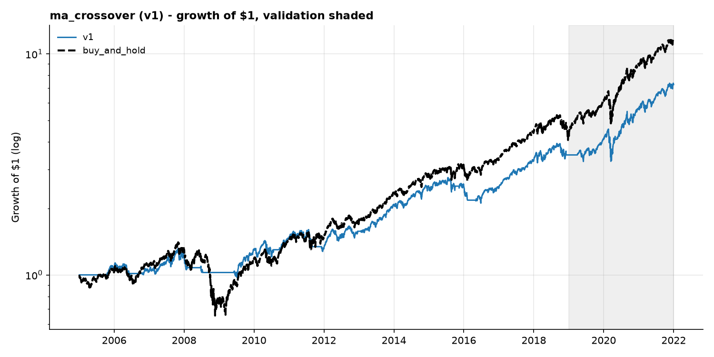
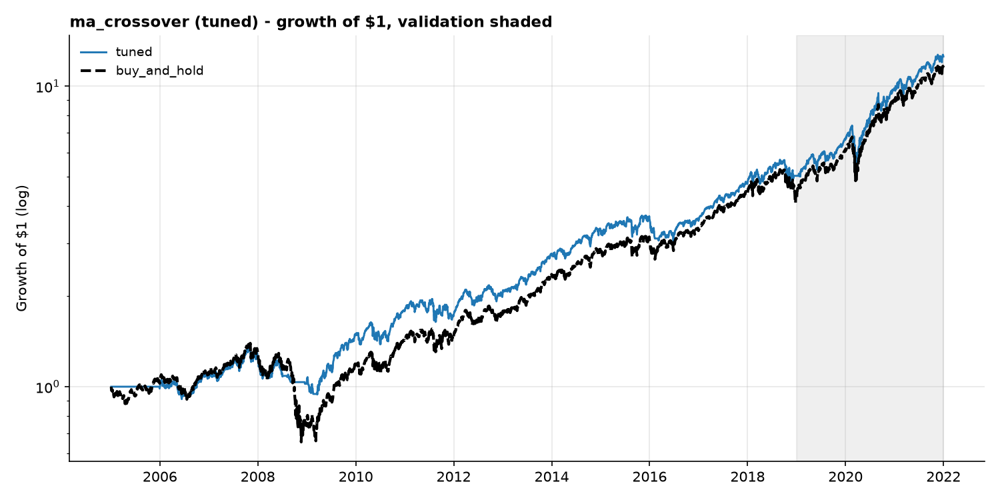
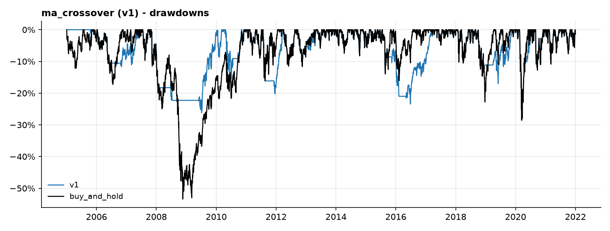
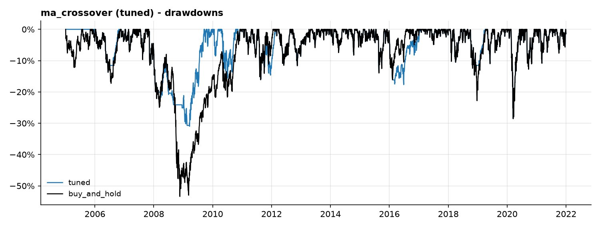
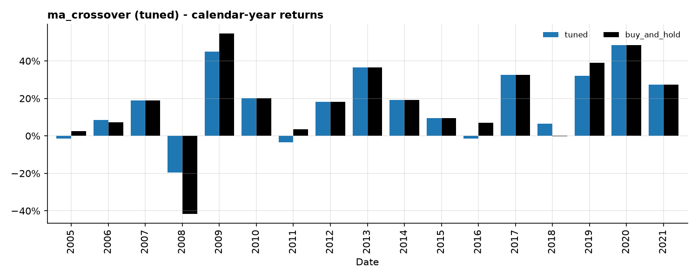

# Slot 1: Moving-average crossover, results

Development-period results (train + validation) for both versions of the strategy. All figures are net of **5 bps** one-way transaction costs and computed on dividend-adjusted QQQ prices. The **test period (2022 →) is not included**; it is run once at the end of the project.

| Case | Configuration | Folder |
|---|---|---|
| **v1** (baseline) | SMA 50/200 crossover, long/flat | [`v1/`](v1/) |
| **tuned** (current default) | SMA 50/250 crossover, long/flat, **plus fast re-entry** when price > SMA 50 | [`tuned/`](tuned/) |

How the tuned version was chosen: [`notebooks/01_moving_average/tuning.ipynb`](../../../notebooks/01_moving_average/tuning.ipynb)

## Side by side

### Train (2005-01-03 → 2018-12-31)
| | Mean daily ret | Std daily ret | Ann. mean ret | Ann. vol | CAGR | Sharpe | Cum. ret | Max DD | Exposure | # trades |
|---|---|---|---|---|---|---|---|---|---|---|
| v1 | 0.040% | 0.93% | 10.0% | 14.8% | 9.4% | 0.68 | 249% | **−26.2%** | 76% | 18 |
| tuned | 0.051% | 1.04% | **12.9%** | 16.6% | **12.3%** | **0.78** | **403%** | −31.0% | 86% | 38 |
| buy & hold | 0.050% | 1.27% | 12.6% | 20.2% | 11.1% | 0.62 | 338% | −53.4% | 100% | 1 |

### Validation (2019-01-02 → 2021-12-31)
| | Mean daily ret | Std daily ret | Ann. mean ret | Ann. vol | CAGR | Sharpe | Cum. ret | Max DD | Exposure | # trades |
|---|---|---|---|---|---|---|---|---|---|---|
| v1 | 0.109% | 1.53% | 27.4% | 24.3% | 27.6% | 1.13 | 108% | −28.6% | 90% | 3 |
| tuned | 0.133% | 1.55% | 33.5% | 24.7% | 35.6% | 1.36 | 150% | −28.6% | 99% | 1 |
| buy & hold | 0.140% | 1.57% | **35.3%** | 24.9% | **37.9%** | **1.42** | **163%** | −28.6% | 100% | 0 |

Full metric tables (Sortino, Calmar, hit rate, turnover): [`v1/metrics.md`](v1/metrics.md), [`tuned/metrics.md`](tuned/metrics.md).

## Takeaways
1. **Both versions cut the 2008 drawdown roughly in half** (−26% / −31% vs −53%), with lower volatility than buy-and-hold.
2. **Tuned beats buy-and-hold on train in return and risk.** CAGR is 12.3% vs 11.1%, Sharpe 0.78 vs 0.62. v1 had better risk but lower return.
3. **Fast re-entry fixes v1's weakness:** v1 sat out the 2020 COVID rebound (validation Sharpe 1.13); tuned rode it (1.36).
4. **Neither version beats buy-and-hold in validation.** 2019–21 was an almost uninterrupted bull market, and a trend filter can only lose a little there. The tuned version is 99% invested, so it is nearly identical to buy-and-hold in this period.
5. **Caveat:** the 95% bootstrap confidence intervals for Sharpe are about ±0.5 and overlap for all three, so the Sharpe differences are not statistically significant. The robust difference is the smaller drawdown in sustained bear markets.

## Figures
| | v1 | tuned |
|---|---|---|
| Growth of $1 |  |  |
| Drawdowns |  |  |
| Calendar-year returns |  |  |

## Files in each folder
`params.json` (configuration) · `metrics.csv` / `metrics.md` (vs buy-and-hold) · `metrics_train.json`, `metrics_validation.json` · `annual_returns.csv` · `positions.csv` (daily position, train + validation) · `equity.png`, `drawdown.png`, `annual_returns.png`

## Reproduce
```bash
python scripts/export_results.py ma_crossover v1 --params '{"short_window": 50, "long_window": 200, "reentry_window": null}'
python scripts/export_results.py ma_crossover tuned
```
