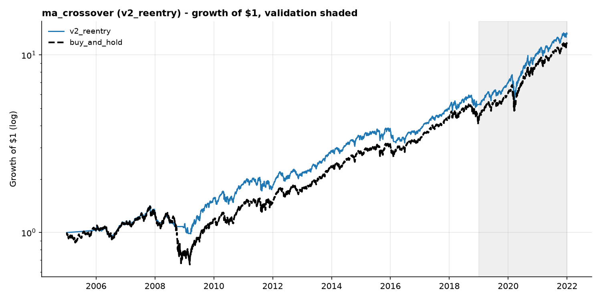
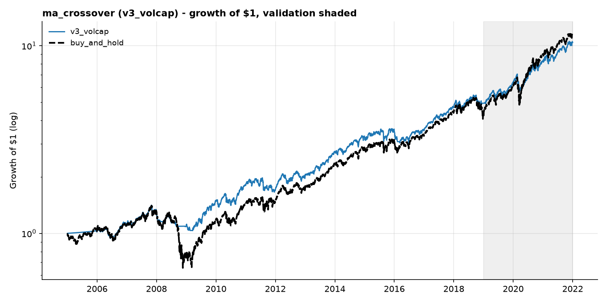
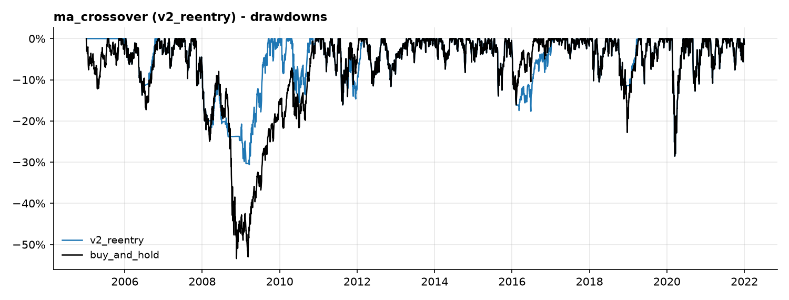
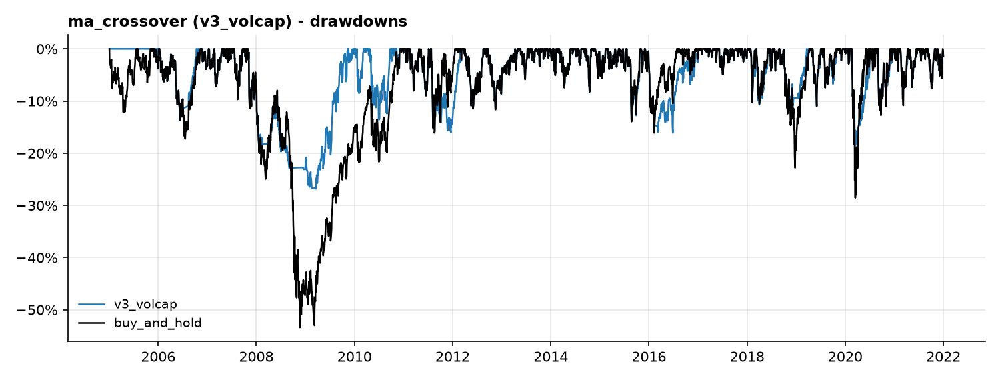
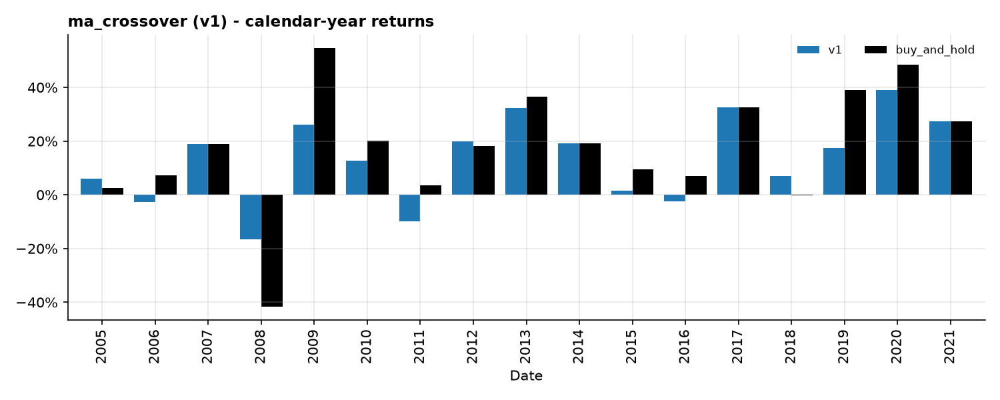

# Slot 1: Moving-average crossover, results

Development-period results (train + validation) for each version of the strategy. All figures are net of **5 bps** one-way transaction costs and computed on dividend-adjusted QQQ prices. **Uninvested cash earns the 13-week T-bill rate**, and **Sharpe is measured in excess of T-bills** (see `data/README.md`). The **test period (2022 →) is not included**; it is run once at the end of the project.

| Version | Configuration | Folder |
|---|---|---|
| **v1** (baseline) | SMA 50/200 crossover, long/flat | [`v1/`](v1/) |
| **v2** (re-entry) | SMA 50/250 crossover + **fast re-entry** when price > SMA 50 | [`v2_reentry/`](v2_reentry/) |
| **v3** (current default) | v2 + **volatility cap**: position × min(1, 20.2% ÷ 20-day realized vol), rebalanced only on moves of more than 10 points | [`v3_volcap/`](v3_volcap/) |

How each version was chosen, with every rule fixed before looking at results: [`notebooks/01_moving_average/tuning.ipynb`](../../../notebooks/01_moving_average/tuning.ipynb). The 20.2% cap is **QQQ's own realized volatility over the training period**, computed inside `fit()`. It was not tuned on validation.

## Side by side

### Train (2005-01-03 → 2018-12-31)
| | Mean daily ret | Std daily ret | Ann. mean ret | Ann. vol | CAGR | Sharpe | Cum. ret | Max DD | Exposure | # trades |
|---|---|---|---|---|---|---|---|---|---|---|
| v1 | 0.041% | 0.93% | 10.4% | 14.7% | 9.8% | 0.62 | 268% | **−25.4%** | 76% | 18 |
| v2 | 0.053% | 1.04% | **13.2%** | 16.5% | **12.6%** | 0.73 | **426%** | −30.6% | 86% | 38 |
| **v3** | 0.050% | 0.93% | 12.5% | 14.8% | 12.1% | **0.76** | 394% | −26.8% | 82% | 114 |
| buy & hold | 0.050% | 1.27% | 12.6% | 20.2% | 11.1% | 0.56 | 338% | −53.4% | 100% | 1 |

### Validation (2019-01-02 → 2021-12-31)
| | Mean daily ret | Std daily ret | Ann. mean ret | Ann. vol | CAGR | Sharpe | Cum. ret | Max DD | Exposure | # trades |
|---|---|---|---|---|---|---|---|---|---|---|
| v1 | 0.109% | 1.53% | 27.6% | 24.3% | 27.9% | 1.10 | 109% | −28.6% | 90% | 3 |
| v2 | 0.133% | 1.55% | 33.5% | 24.7% | 35.6% | 1.33 | 150% | −28.6% | 99% | 1 |
| **v3** | 0.105% | 1.12% | 26.4% | **17.8%** | 28.1% | **1.44** | 111% | **−19.0%** | 88% | 45 |
| buy & hold | 0.140% | 1.57% | **35.3%** | 24.9% | **37.9%** | 1.38 | **163%** | −28.6% | 100% | 0 |

Full metric tables (Sortino, Calmar, hit rate, turnover): [`v1/metrics.md`](v1/metrics.md), [`v2_reentry/metrics.md`](v2_reentry/metrics.md), [`v3_volcap/metrics.md`](v3_volcap/metrics.md).

## Takeaways
1. **All versions roughly halve the 2008 drawdown** (−25% to −31% vs −53%), at lower volatility than buy-and-hold.
2. **v2's fast re-entry fixes v1's COVID problem.** v1 sat out the 2020 rebound; v2 rode it (validation Sharpe 1.10 → 1.33).
3. **v3's volatility cap is the first version to beat buy-and-hold on risk-adjusted return in *both* periods.** Its Sharpe is 0.76 vs 0.56 on train and 1.44 vs 1.38 on validation, and its validation max drawdown is −19% vs −29%. It holds less stock when markets are turbulent, which is when crashes cluster (Moreira & Muir 2017).
4. **The trade-off is lower raw return in strong bull markets.** In validation v3 earned 28.1% a year vs 37.9% for buy-and-hold, at about 70% of its volatility. The strategy aims for better *risk-adjusted* return, not maximum return.
5. **Trading:** v3 makes more, smaller trades (114 on train). Costs barely matter: Sharpe falls only 0.77 → 0.74 between 0 and 20 bps.
6. **Caveat:** 95% bootstrap confidence intervals for Sharpe are about ±0.5 and overlap for all versions and buy-and-hold, so the Sharpe differences are not statistically significant. The more robust improvement is the smaller drawdowns and volatility.

## Ideas tested and rejected
These were tested on train using published approaches (Sharpe in excess of T-bills, same engine as above; v2 = 0.73, buy & hold = 0.56):
- **Monthly or weekly signals (Faber 2007):** exited too late (0.63 / 0.71).
- **12-month momentum filter (Clare et al. 2013):** with AND it cut out good periods; with OR it re-entered too early (0.57 / 0.69).
- **KAMA adaptive moving average:** whipsawed badly (0.04).
- **Faber's exact 10-month rule on QQQ:** 0.58, barely above buy-and-hold.

## Figures
| | v1 | v2 | v3 |
|---|---|---|---|
| Growth of $1 |  |  |  |
| Drawdowns |  |  |  |
| Calendar-year returns |  |  |  |

## Files in each folder
`params.json` (configuration) · `metrics.csv` / `metrics.md` (vs buy-and-hold) · `metrics_train.json`, `metrics_validation.json` · `annual_returns.csv` · `positions.csv` (daily position, train + validation) · `equity.png`, `drawdown.png`, `annual_returns.png`

## Reproduce
```bash
python scripts/export_results.py ma_crossover v1 --params '{"short_window": 50, "long_window": 200, "reentry_window": null, "vol_target": null}'
python scripts/export_results.py ma_crossover v2_reentry --params '{"vol_target": null}'
python scripts/export_results.py ma_crossover v3_volcap
```
