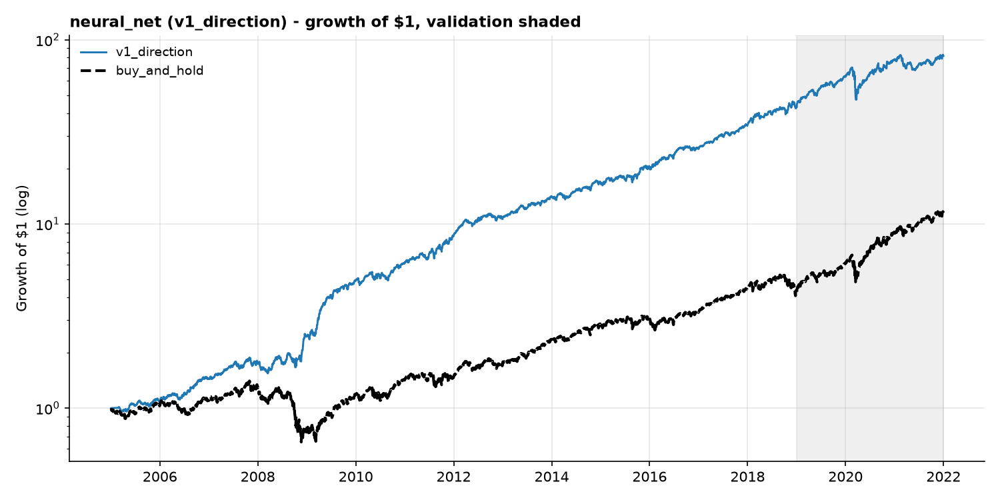
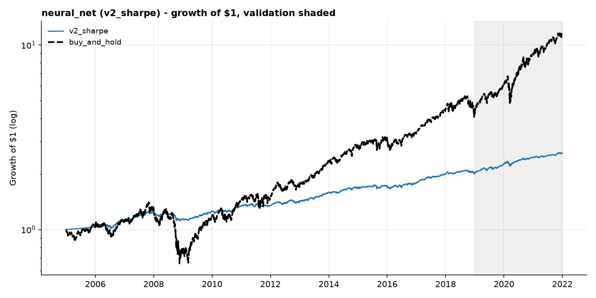
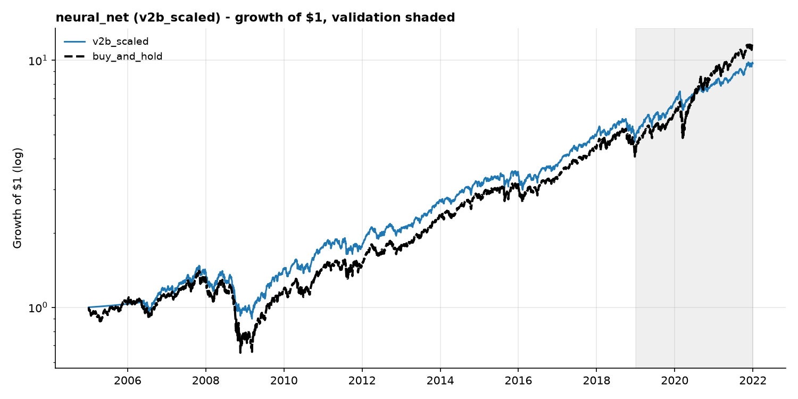
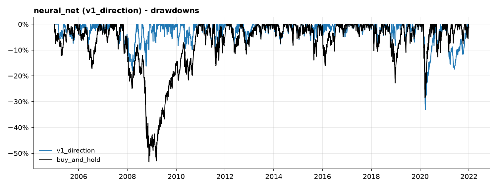
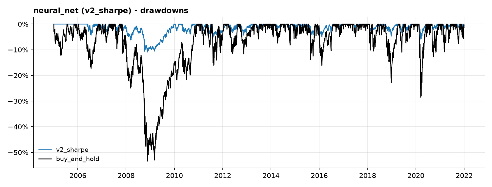
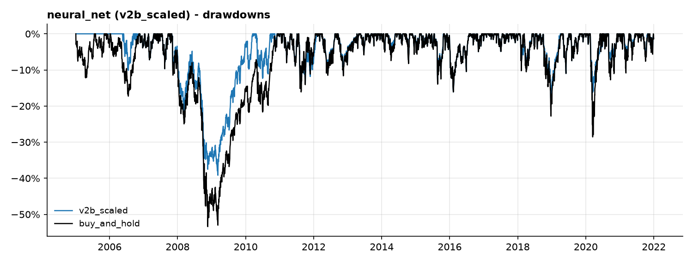
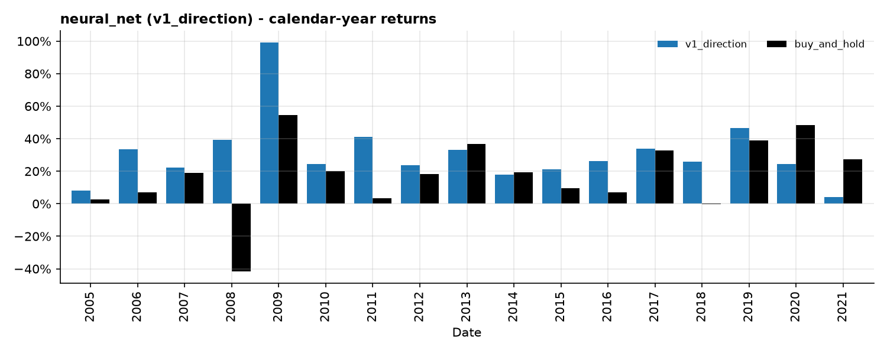
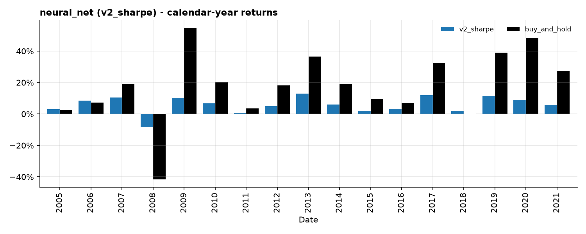
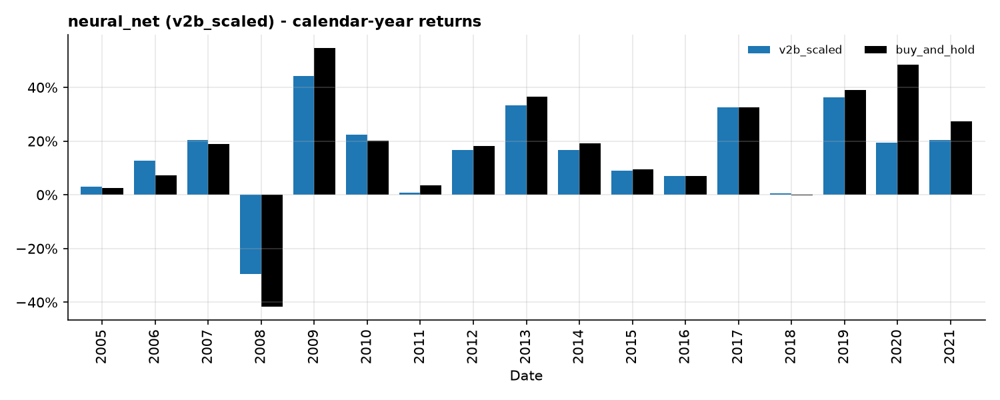

# Slot 2: Neural network, results

Development-period results (train + validation) for each version. All figures are:
- net of **5 bps** one-way costs, on dividend-adjusted QQQ;
- with **uninvested cash earning the 13-week T-bill rate**, and **Sharpe in excess of T-bills**.

The **test period (2022 →) is not included**. It is run once, at the end of the project.

| Version | Configuration | Folder |
|---|---|---|
| **v1** (the brief's design) | MLP (32, 16) classifies tomorrow's direction from 20 days of lagged OHLC features. Long if P(up) > 0.5, else cash | [`v1_direction/`](v1_direction/) |
| **v2** (Sharpe-trained) | MLP (32, 16) **outputs the position** from momentum and volatility features, trained on −Sharpe with a 25 bps turnover penalty. 10-point rebalance band | [`v2_sharpe/`](v2_sharpe/) |
| **v2b** (current default) | v2 with its output **rescaled** so its train-period volatility equals QQQ's: min(1, k × output), k = 3.84 | [`v2b_scaled/`](v2b_scaled/) |

How each version was chosen, with every rule written down before results were seen (v2b's rule is a marked post-hoc addendum): [`notebooks/02_neural_net/PROTOCOL.md`](../../../notebooks/02_neural_net/PROTOCOL.md). The model search covers 5 families, 40 configurations and an LSTM, using a walk-forward inside train: [`research/`](research/).

> **Train numbers of fitted models are in-sample.** Each network is fitted on 2005–2018 and then evaluated on 2005–2018. The honest train-period estimate is the **walk-forward Sharpe**: four expanding folds where each 2-year evaluation window is never seen by the model that trades it (2011–2018).

## Side by side

| | Walk-forward Sharpe 2011–18 (out-of-fold) | Train Sharpe (in-sample) | Train max DD | Validation Sharpe | Validation CAGR | Validation max DD | Validation exposure | # trades (val) |
|---|---|---|---|---|---|---|---|---|
| v1 direction | 0.91 | 1.64 ⚠️ | −18.0% | 1.09 | 23.9% | −33.2% | 79% | 241 |
| v2 Sharpe | **0.92** | 0.77 | **−10.9%** | 1.51 | 8.6% | **−5.9%** | 23% | 8 |
| **v2b Sharpe, rescaled** | 0.89 | 0.72 | −39.2% | **1.53** | 25.1% | −16.2% | 74% | 27 |
| buy & hold | 0.89 | 0.56 | −53.4% | 1.38 | **37.9%** | −28.6% | 100% | 0 |

⚠️ v1's 1.64 is memorisation. Its out-of-fold Sharpe is 0.91, and on validation it falls to 1.09 with a **worse** drawdown than buy-and-hold.

Full metric tables (mean and std of daily returns, annualised values, Sortino, Calmar, hit rate, turnover): [`v1_direction/metrics.md`](v1_direction/metrics.md), [`v2_sharpe/metrics.md`](v2_sharpe/metrics.md), [`v2b_scaled/metrics.md`](v2b_scaled/metrics.md).

## Takeaways
1. **Predicting tomorrow's direction does not work on QQQ.**
   - Validation AUC is **0.504**, a coin flip.
   - Out of sample, held-out cross-entropy never beats the coin-flip loss ln 2, while training loss falls towards 0.1 (memorisation).
   - Individual seeds range from 0.46 to 0.97 walk-forward Sharpe (sd 0.20).
   - The LSTM version is worse (walk-forward 0.18).
2. **Training the network on the Sharpe ratio instead of direction (Lim, Zohren & Roberts 2019) gives a stable, interpretable strategy.**
   - Across seeds the walk-forward Sharpe has sd 0.05.
   - On its own, the network learned to **hold less when volatility is high** (correlation −0.79 between position and 60-day volatility) and **slightly less after losses** (+0.40 with 3-month return). That is volatility targeting plus trend: the two effects the literature supports.
3. **The level of a Sharpe-trained position is arbitrary.** Sharpe doesn't change when every position is multiplied by the same constant, so v2 settled at about 25% invested. v2b rescales it to QQQ's own volatility, giving ≈80% average exposure and a comparable return level.
4. **v2b beats buy-and-hold on validation Sharpe (1.53 vs 1.38) with about half the drawdown (−16% vs −29%).** It cut the COVID crash to −15.8% (buy-and-hold: −27.9%). On the out-of-fold train period it only **ties** buy-and-hold (0.89 vs 0.89).
5. **Costs barely matter.** Sharpe is 0.73 → 0.72 on train and 1.54 → 1.52 on validation from 0 to 20 bps, with 0.6–1.1× capital traded per year.
6. **Caveat:** none of these Sharpe differences are statistically significant.
   - v2b's 95% block-bootstrap CIs are [0.25, 1.25] on train and [0.39, 2.75] on validation.
   - Buy-and-hold's are [0.12, 1.09] and [0.29, 2.68].

## Stress episodes (cumulative return; * = inside the training period, so in-sample for the networks)
| Episode | v1 | v2 | v2b | Slot 1 v3 | Buy & hold |
|---|---|---|---|---|---|
| Financial crisis (31 Oct 2007 – 9 Mar 2009)* | +36.4% ⚠️ | −10.3% | −38.4% | −25.7% | −52.3% |
| Q4 2018 sell-off (1 Oct – 24 Dec 2018)* | −0.3% | −4.7% | −18.9% | −9.2% | −22.5% |
| COVID crash (20 Feb – 23 Mar 2020) | **−33.1%** | −5.7% | −15.8% | −18.2% | −27.9% |
| COVID crash and rebound (20 Feb – 31 Dec 2020) | +10.7% | +5.0% | +7.6% | +18.0% | +33.1% |

v1's "profit" through 2008 happened in data it was trained on. In the first crash it had **not** seen (COVID), it lost more than buy-and-hold.

## Ideas tested and rejected (walk-forward Sharpe 2011–2018; buy & hold = 0.89)
- **Direction classifier with the "base-rate" threshold** (long only if P(up) > the train share of up days): 0.10–0.75. It traded 640–850 times and paid for it.
- **LSTM direction classifier** (20- and 63-day sequences): 0.16 / 0.18. It almost never got confident enough to go long.
- **LSTM trained on Sharpe** (Lim et al.'s best architecture): 0.92, but no better than the MLP (0.92). It also needs PyTorch, so it was not adopted (protocol step 3).
- **Neural volatility forecast used for sizing:**
  - It forecasts volatility much better than a 20-day average (QLIKE 0.28 vs 0.47 at 21 days; on par with or slightly better than the HAR model, 0.31).
  - But it **traded worse**: 0.79–0.85 vs 0.91 for plain 20-day-volatility sizing. Better forecasts did not translate into better trading.

## Figures
| | v1 | v2 | v2b |
|---|---|---|---|
| Growth of $1 |  |  |  |
| Drawdowns |  |  |  |
| Calendar-year returns |  |  |  |

Research figures (`notebooks/02_neural_net/figures/`):
- `overfitting_curves.png`: train vs held-out loss
- `what_it_learned.png`: v2b's position against volatility and momentum
- `family_comparison.png`: all families vs buy-and-hold

## Reproduce
```bash
python notebooks/02_neural_net/nn_research.py --lstm          # model search (~7 min; LSTM needs torch)
python notebooks/02_neural_net/make_figures.py                # figures + stress table (~10 s)
python scripts/export_results.py neural_net v1_direction --params '{"mode": "direction", "lags": 20, "hidden": [32, 16], "threshold": 0.5, "l2": 0.01, "band": 0.0, "scale": "none"}'
python scripts/export_results.py neural_net v2_sharpe --params '{"scale": "none"}'
python scripts/export_results.py neural_net v2b_scaled
```
Every run is seeded, and a from-scratch rerun reproduces every number in `research/` exactly.
